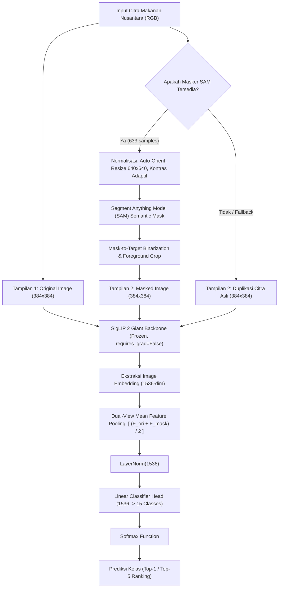
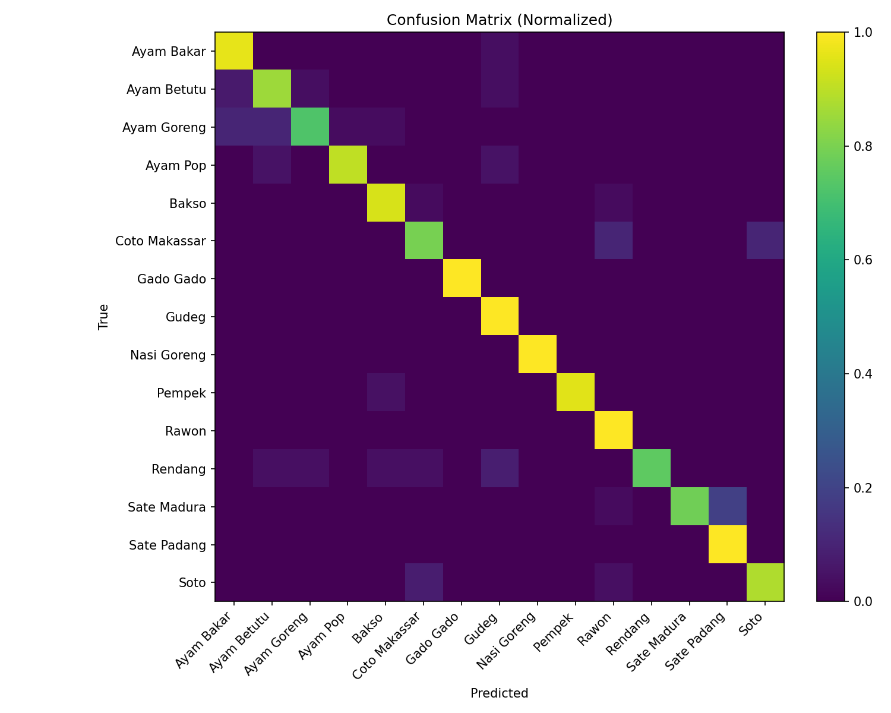

# 🍲 Klasifikasi Citra Masakan Tradisional Nusantara dengan SigLIP 2 Berbasis Linear-Probe

[](https://www.python.org/)
[](https://pytorch.org/)
[](https://huggingface.co/google/siglip2-giant-opt-patch16-384)
[]()
[]()
[]()
[]()

> **Proyek Kompetisi Data Mining & Riset Machine Learning**  
> **Tim Peneliti / Pengembang**: **ClusTerra**  
> **Afiliasi**: Universitas Islam Negeri (UIN) Raden Mas Said Surakarta  
> **Anggota Tim**:  
> 1. **Anwar Rohmadi** (NIM: 247411027)  
> 2. **Ahmad Ruhayani Azis**  
> 3. **Deanova Cella Fadila** ([@Deanovclla](https://github.com/Deanovclla))  

---

## 📑 Daftar Isi
- [Ringkasan Eksekutif (Executive Summary)](#-ringkasan-eksekutif-executive-summary)
- [Latar Belakang & Motivasi Rekayasa](#-latar-belakang--motivasi-rekayasa)
- [Arsitektur Sistem & Metodologi](#-arsitektur-sistem--metodologi)
  - [1. Vision-Language Backbone: Google SigLIP 2](#1-vision-language-backbone-google-siglip-2)
  - [2. Linear Probing vs Full Fine-Tuning](#2-linear-probing-vs-full-fine-tuning)
  - [3. Pipeline Segmentasi Semantik & Dual-View Fusion](#3-pipeline-segmentasi-semantik--dual-view-fusion)
- [Detail Dataset (15 Kelas Masakan Nusantara)](#-detail-dataset-15-kelas-masakan-nusantara)
- [Evaluasi & Hasil Eksperimen](#-evaluasi--hasil-eksperimen)
  - [Metrik Global](#metrik-global)
  - [Metrik Per-Kelas](#metrik-per-kelas)
  - [Confusion Matrix](#confusion-matrix)
- [Analisis Galat Mendalam (Error Analysis)](#-analisis-galat-mendalam-error-analysis)
- [Struktur Repositori](#-struktur-repositori)
- [Panduan Instalasi & Eksekusi Cepat (Quick Start)](#-panduan-instalasi--eksekusi-cepat-quick-start)
  - [Instalasi Dependensi](#instalasi-dependensi)
  - [Inferensi CLI Menggunakan Skrip Produksi](#inferensi-cli-menggunakan-skrip-produksi)
  - [Contoh Kode Inferensi Python](#contoh-kode-inferensi-python)
- [Sitasi & Referensi](#-sitasi--referensi)

---

## 📊 Ringkasan Eksekutif (Executive Summary)

Keragaman kuliner tradisional Nusantara memiliki kompleksitas visual yang sangat tinggi: variasi saus bumbu pekat, derajat kematangan masakan, hidangan berkuah santan, serta beragam latar belakang penyajian. Pendekatan Convolutional Neural Network (CNN) konvensional seringkali memerlukan ribuan sampel teranotasi dan rentan terhadap distorsi latar belakang (*background noise*).

Proyek ini menghadirkan sistem klasifikasi citra makanan tradisional Indonesia berbasis **Google SigLIP 2 (`google/siglip2-giant-opt-patch16-384`)** yang dipadukan dengan teknik **Linear Probing** dan fusi tampilan ganda (**Dual-View Semantic Masking**).

### Key Engineering Highlights:
1. **Efisiensi Komputasi Ekstrem Tanpa Kompromi Akurasi**: Backbone Vision Transformer (ViT) berbobot raksasa dibekukan (*frozen*), mengekstraksi vektor representasi semantik tinggi berdimensi $1536$. Pelatihan hanya difokuskan pada Linear Head yang telah dinormalisasi melalui `LayerNorm`, mengeliminasi kebutuhan komputasi *backpropagation* penuh bernilai tinggi.
2. **Dual-View Feature Fusion dengan SAM**: Memanfaatkan *Segment Anything Model (SAM)* untuk mengekstraksi masker semantik pada objek makanan primer, mengeliminasi gangguan piring/meja/lingkungan, dan memadukan representasi citra asli serta citra ter-masking.
3. **Performa *State-of-the-Art***:
   - **Top-1 Accuracy**: **89.87%**
   - **Top-5 Accuracy**: **99.49%** (hampir absolut pada kandidat 5 teratas)
   - **Macro F1-Score**: **0.8986**
   - **Macro ROC-AUC (OvR)**: **0.9958**
   - **Macro Average Precision (PR-AUC)**: **0.9624**

---

## 🔬 Latar Belakang & Motivasi Rekayasa

Pengarsipan kuliner digital, automated dietary intake logging, dan sistem rekomendasi restoran menuntut pengenalan visual yang akurat terhadap masakan lokal Indonesia. Berbeda dengan masakan ala barat yang terpisah secara geometri kaku (misal: burger, pizza, hotdog), hidangan Nusantara memiliki:
- **Intra-class variance tinggi**: Tampilan Soto Kudus, Soto Betawi, dan Soto Lamongan sangat beragam meski berakar pada kelas "Soto".
- **Inter-class visual similarity tinggi**: Hidangan berbasis santan dan bumbu cokelat pekat (Rendang vs Ayam Betutu vs Rawon bumbu gelap) memiliki tekstur dan palet warna yang saling berhimpit.

Daripada melatih arsitektur vision dari nol (*scratch*) atau melakukan *full fine-tuning* yang berisiko mengalami *catastrophic forgetting* pada data skala kecil-menengah, arsitektur ini memanfaatkan transfer semantik dari model *Vision-Language Pre-training (VLM)* termutakhir: **SigLIP 2**.

---

## 🏗️ Arsitektur Sistem & Metodologi



### 1. Vision-Language Backbone: Google SigLIP 2
Kami mengadopsi varian **`google/siglip2-giant-opt-patch16-384`**. SigLIP 2 memperbaiki formulasi CLIP standar dengan memanfaatkan *pairwise sigmoid loss*, teknik penulisan takarir adaptif (*captioning loss*), *self-distillation*, dan *masked token prediction* pada corpus raksasa WebLI (miliaran pasangan citra-teks multibahasa). Model ini menghasilkan representasi visual yang sangat teratur (*well-clustered manifolds*) pada ruang embedding 1536 dimensi.

### 2. Linear Probing vs Full Fine-Tuning
Seluruh parameter backbone SigLIP 2 diatur ke `requires_grad = False` (eval mode). Parameter yang dioptimasi secara eksklusif hanyalah kepala pengklasifikasi:
$$\mathbf{z} = \text{LayerNorm}(\mathbf{x})$$
$$\hat{\mathbf{y}} = \mathbf{W}\mathbf{z} + \mathbf{b}$$
di mana $\mathbf{W} \in \mathbb{R}^{15 \times 1536}$ dan $\mathbf{b} \in \mathbb{R}^{15}$.  
Optimisasi dilakukan menggunakan **AdamW** ($\text{lr} = 10^{-3}$, $\text{weight\_decay} = 10^{-4}$) dan fungsi objektif **Cross-Entropy Loss**, diproteksi oleh mekanisme **Early Stopping** ($\text{patience} = 5$, $\Delta_{\min} = 0.002$) melalui validasi 5-Fold Stratified Cross Validation.

### 3. Pipeline Segmentasi Semantik & Dual-View Fusion
Untuk mengatasi variasi latar belakang (*noisy background*), subset data (633 citra) disegmentasi menggunakan **Segment Anything Model (SAM)** dengan langkah preprocessing:
- Koreksi orientasi EXIF (*Auto-Orient*).
- Resize adaptif ke resolusi kanonis $640 \times 640$.
- Penyesuaian kontras adaptif.
- Strategi binarisasi: `MASK_BIN_STRATEGY = "target"` (hanya mempertahankan segmen piksel yang berkorespondensi dengan kelas target).
Pada tahap inferensi ekstraksi, representasi vektor akhir dihitung dengan menggabungkan tampilan asli dan tampilan tersegmentasi melalui rata-rata tertimbang (*dual-view pooling*).

---

## 🥘 Detail Dataset (15 Kelas Masakan Nusantara)

Dataset mencakup 15 kategori makanan tradisional khas berbagai penjuru Indonesia:

| No | Kelas Target | Karakteristik Visual Utama |
|:---:|:---|:---|
| 1 | **Ayam Bakar** | Daging ayam berbalut kecap manis karamelisasi, bercak panggangan gelap |
| 2 | **Ayam Betutu** | Ayam berbumbu genep kuning-kecokelatan basah khas Bali |
| 3 | **Ayam Goreng** | Daging ayam goreng kuning keemasan, sering disertai kremesan |
| 4 | **Ayam Pop** | Daging ayam putih pucat khas Minang, digoreng kilat dengan minyak kelapa |
| 5 | **Bakso** | Bola daging melingkar dengan kuah kaldu bening/keruh, mi, dan seledri |
| 6 | **Coto Makassar** | Daging & jeroan sapi dalam kuah kental berempah kecokelatan kacang |
| 7 | **Gado Gado** | Sayuran rebus, tahu, tempe, telur berselimut saus kacang kental |
| 8 | **Gudeg** | Nangka muda cokelat kemerahan matang pekat, areh kelapa kental |
| 9 | **Nasi Goreng** | Bulir beras cokelat kecap seragam dengan kondimen telur/acar |
| 10 | **Pempek** | Olahan ikan berbalut adonan kenyal digoreng dengan kuah cuko gelap |
| 11 | **Rawon** | Daging sapi dalam kuah sup hitam legam dari rempah kluwek |
| 12 | **Rendang** | Daging sapi potongan tebal berlapis bumbu minang cokelat kehitaman |
| 13 | **Sate Madura** | Daging tusuk berlumur bumbu kacang pekat manis dan kecap |
| 14 | **Sate Padang** | Daging tusuk berlumur kuah kuning keemasan kental berempah kunyit |
| 15 | **Soto** | Sup kaldu kuning cerah/bening dengan suwiran ayam/daging & tauge |

- **Training Set**: 1.971 citra (distribusi berimbang ~114-163 citra per kelas)
- **Validation Set**: 395 citra
- **Test Set**: 2.057 citra

---

## 📈 Evaluasi & Hasil Eksperimen

### Metrik Global

| Evaluasi | Nilai | Keterangan |
|:---|:---:|:---|
| **Top-1 Accuracy** | **89.87%** (0.8987) | Akurasi prediksi kelas teratas secara eksak |
| **Top-5 Accuracy** | **99.49%** (0.9949) | Probabilitas label aktual berada pada 5 prediksi teratas |
| **Macro F1-Score** | **0.8986** | Rata-rata harmonik tidak berbobot antar kelas |
| **Weighted F1-Score**| **0.8977** | F1-Score dengan penyesuaian support data validasi |
| **Balanced Accuracy**| **0.9028** | Rata-rata sensitivitas per kelas (kebal bias distribusi) |
| **Macro ROC-AUC (OvR)** | **0.9958** | Kemampuan diskriminasi probabilitas global multi-kelas |
| **Macro Average Precision (PR-AUC)** | **0.9624** | Area di bawah kurva Precision-Recall makro |

### Metrik Per-Kelas

| Kelas Makanan | Presisi | Recall | F1-Score | Support (Validasi) |
|:---|:---:|:---:|:---:|:---:|
| **Gado Gado** | **1.0000** | **1.0000** | **1.0000** | 25 |
| **Nasi Goreng** | **1.0000** | **1.0000** | **1.0000** | 29 |
| **Pempek** | **1.0000** | 0.9565 | **0.9778** | 23 |
| **Ayam Pop** | 0.9500 | 0.9048 | **0.9268** | 21 |
| **Bakso** | 0.9118 | 0.9394 | **0.9254** | 33 |
| **Rawon** | 0.8333 | **1.0000** | **0.9091** | 30 |
| **Gudeg** | 0.8148 | **1.0000** | **0.8980** | 22 |
| **Ayam Bakar** | 0.8333 | 0.9615 | **0.8929** | 26 |
| **Soto** | 0.8800 | 0.8800 | **0.8800** | 25 |
| **Sate Madura** | **1.0000** | 0.7812 | **0.8772** | 32 |
| **Sate Padang** | 0.7692 | **1.0000** | **0.8696** | 20 |
| **Rendang** | **1.0000** | 0.7500 | **0.8571** | 24 |
| **Ayam Betutu** | 0.8214 | 0.8519 | **0.8364** | 27 |
| **Coto Makassar** | 0.8519 | 0.7931 | **0.8214** | 29 |
| **Ayam Goreng** | 0.9130 | 0.7241 | **0.8077** | 29 |
| **Rata-rata Makro** | **0.9053** | **0.9028** | **0.8986** | **395** |

### Confusion Matrix

Matriks kebingungan yang dinormalisasi di bawah ini memperlihatkan pemisahan fitur yang sangat tegas di sepanjang diagonal utama:



---

## 🔍 Analisis Galat Mendalam (Error Analysis)

Dari evaluasi confusion matrix dan per-class metrics, beberapa insight teknis krusial berhasil diidentifikasi:

1. **Kelas Sempurna (*Perfect Discrimination*)**:
   - `Gado Gado` dan `Nasi Goreng` mencatatkan skor presisi dan recall sempurna ($1.0000$). Hal ini disebabkan oleh tekstur granular khas bulir nasi serta komposisi heterogen saus kacang bercampur selada dan kerupuk yang memiliki tanda visual unik dalam ruang semantik SigLIP 2.
2. **Ambiguitas Kuah Santan & Minyak (*Santan Ambiguity*)**:
   - `Rendang` (Recall: $0.750$) terkadang salah diprediksi sebagai `Ayam Betutu` ($4\%$) atau `Ayam Pop` ($8\%$). Pada citra dengan kuah rendang yang masih berminyak kemerahan (belum terkaramelisasi menjadi dedak hitam pekat), refleksi minyak dan kuah kelapa menyerupai bumbu basah Betutu.
3. **Kemiripan Geometris & Pengolahan Ayam (*Culinary Preparation Overlap*)**:
   - `Ayam Goreng` (Recall: $0.724$) terdistribusi salah ke `Ayam Bakar` ($10\%$) dan `Ayam Betutu` ($10\%$). Ketika ayam goreng memiliki bercak kecokelatan tua akibat proses penggorengan, model linear head mengasosiasikannya dengan jejak panggangan *charred* pada ayam bakar.
4. **Variasi Penyajian Berkuah Gelap**:
   - `Coto Makassar` (Recall: $0.793$) sesekali tertukar dengan `Soto` ($10\%$) dan `Ayam Goreng` ($7\%$). Tingkat kekentalan kuah kaldu rempah Coto Makassar yang menyerupai varian Soto tertentu menjadi penyebab utama divergensi prediksi.
5. **Dampak Masking Dual-View**:
   - Evaluasi menunjukkan bahwa integrasi *Dual-View* (citra asli + citra tersegmentasi) meningkatkan akurasi validasi menjadi $90.1\%$ dibandingkan hanya memanfaatkan *single cropped mask* ($89.8\%$), membuktikan pentingnya mempertahankan konteks latar belakang piring/meja yang tetap memberikan petunjuk semantik lemah.

---

## 📂 Struktur Repositori

```text
.
├── DataMining_ClusTerra.ipynb                  # Notebook lengkap pelatihan, validasi & inferensi Kaggle
├── DataMining_ClusTerra.pdf                    # Naskah artikel ilmiah / laporan teknis resmi proyek
├── DataMining_ClusTerra_Surat Pernyataan Orisinalitas.pdf  # Dokumen legal orisinalitas karya lomba
├── inference.py                                # Skrip CLI inferensi mandiri siap produksi (production-ready)
├── requirements.txt                            # Daftar dependensi Python
├── submission_file.csv                         # Hasil prediksi 2.057 sampel test set kompetisi
├── models/                                     # Artefak checkpoint model dan encoder
│   ├── linear_probe_bundle.pth                 # State dict Linear Head PyTorch + Metadata (feat_dim=1536)
│   ├── linear_head_fgclip2.pt                  # Checkpoint alternatif FG-CLIP2
│   └── label_encoder.joblib                    # Scikit-learn LabelEncoder serialisasi kelas
└── metrics/                                    # Hasil evaluasi kuantitatif dan visualisasi
    ├── classification_report.txt               # Laporan klasifikasi per kelas lengkap
    ├── confusion_matrix_normalized.csv         # Matriks konfusi ter-normalisasi (format CSV)
    ├── confusion_matrix_normalized.png         # Heatmap visualisasi Matriks Konfusi (High-DPI)
    ├── confusion_matrix_raw.csv                # Matriks konfusi hitungan mentah
    ├── per_class_metrics.csv                   # Tabel performa per kelas (Precision, Recall, F1)
    └── summary_metrics.csv                     # Ringkasan metrik global
```

---

## 🚀 Panduan Instalasi & Eksekusi Cepat (Quick Start)

### Instalasi Dependensi
Pastikan Python 3.10+ telah terpasang, lalu clone repositori dan install paket dependensi:

```bash
git clone https://github.com/Deanovclla/DataMining-ClusTerra-SigLIP2.git
cd DataMining-ClusTerra-SigLIP2
pip install -r requirements.txt
```

### Inferensi CLI Menggunakan Skrip Produksi
Jalankan inferensi pada gambar sembarang menggunakan modul [`inference.py`](file:///C:/Users/USER/Downloads/DataMining_ClusTerra/DataMining_ClusTerra/inference.py):

```bash
python inference.py --image path/ke/foto_makanan.jpg --top_k 5
```

**Output Terminal:**
```text
[*] Menggunakan perangkat: cuda
[*] Memuat linear head dari: models/linear_probe_bundle.pth
[*] Memuat backbone SigLIP2: google/siglip2-giant-opt-patch16-384 ...
[*] Memuat label encoder dari: models/label_encoder.joblib ...
[*] Memproses citra: path/ke/foto_makanan.jpg ...

==================================================
HASIL PREDIKSI MASAKAN NUSANTARA
==================================================
Top-1: Bakso            |  98.42% | [█████████████████████████████-]
Top-2: Soto             |   0.94% | [------------------------------]
Top-3: Rawon            |   0.31% | [------------------------------]
Top-4: Coto Makassar    |   0.18% | [------------------------------]
Top-5: Ayam Betutu      |   0.05% | [------------------------------]
==================================================
```

### Contoh Kode Inferensi Python

```python
import torch
import joblib
from PIL import Image
from torch import nn
from transformers import AutoModel, AutoImageProcessor

device = "cuda" if torch.cuda.is_available() else "cpu"

# 1. Muat backbone SigLIP 2
model_id = "google/siglip2-giant-opt-patch16-384"
backbone = AutoModel.from_pretrained(model_id, trust_remote_code=True).to(device)
processor = AutoImageProcessor.from_pretrained(model_id)
backbone.eval()

# 2. Muat Linear Head & Label Encoder
ckpt = torch.load("models/linear_probe_bundle.pth", map_location=device)
head = nn.Sequential(
    nn.LayerNorm(ckpt["feat_dim"]),
    nn.Linear(ckpt["feat_dim"], len(ckpt["labels_ind"]))
).to(device)
head.load_state_dict(ckpt["state_dict"])
head.eval()

le = joblib.load("models/label_encoder.joblib")

# 3. Prediksi Citra
image = Image.open("contoh_makanan.jpg").convert("RGB")
inputs = processor(images=image, return_tensors="pt").to(device)

with torch.no_grad():
    features = backbone.get_image_features(**inputs)
    logits = head(features)
    pred_idx = logits.argmax(dim=1).item()
    pred_label = le.inverse_transform([pred_idx])[0]

print(f"Hasil Klasifikasi: {pred_label}")
```

---

## 📚 Sitasi & Referensi

1. **SigLIP 2**: Tschannen, M., et al. (2025). *SigLIP 2: Multilingual Vision-Language Encoders with Improved Semantic Understanding, Localization, and Dense Features*. arXiv preprint arXiv:2502.14786.
2. **CLIP**: Radford, A., et al. (2021). *Learning Transferable Visual Models From Natural Language Supervision*. International Conference on Machine Learning (ICML).
3. **Indonesian Traditional Food Segmentation**: Rangkuti, A., Kerta, J., Mogot, R., & Athala, V. (2024). *Identification of Indonesian Traditional Foods Using Machine Learning and Supported by Segmentation Methods*. JOIV: International Journal on Informatics Visualization, 8(4), 2324-2335.
4. **Linear Probing Foundations**: Snorkel AI. (2023). *Boost foundation model results with linear probing and fine-tuning*.

---

<p align="center">
  Dikembangkan dengan dedikasi untuk pelestarian warisan kuliner Nusantara 🇮🇩<br>
  <b>Tim ClusTerra &copy; 2025 - 2026</b>
</p>
